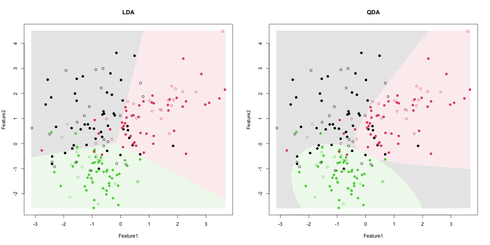

# Discriminant Boundary Comparison

Held-out LDA and QDA evaluation with decision-region visualizations.

## Run

Requires R 4.4+ and packages MASS and jsonlite.

```r
install.packages(c("MASS", "jsonlite"))
```

```sh
Rscript scripts/run.R
Rscript tests/checks.R
```

Generated metrics and figures are saved in `results/`. Read [input provenance](data/README.md) and [method changes](docs/provenance.md).

## Executed results

Seeded stratified holdout: 138 training / 62 test records. LDA accuracy: 0.758; QDA accuracy: 0.790. One small split is not a precise generalization estimate. Filled points are training rows; open points are held out.



## Reproducibility and scope

Seeds are fixed in source. Validation uses numerical invariants or input/split checks. This is a maintained reconstruction of the supplied work; methodological corrections and newly generated data mean some results intentionally differ from the original reports. Original PDFs are omitted to avoid publishing student identifiers.
